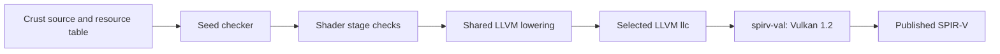

<!-- SPDX-License-Identifier: Apache-2.0 -->

# Compile a Vulkan compute shader

This tutorial compiles a Crust function to SPIR-V. Four invocations read a
buffer, add two, exchange values through workgroup memory, and write the
result. The compiler stage is a Crust library. The root selects its source,
resource interface, LLVM installation, and output file.

## Build the shader

Build the seed and select a released LLVM toolchain:

```sh
make all
make fetch-llvm-release
CRUST_LLVM=$(python3 tools/fetch_llvm.py release --locked)
```

Install SPIRV-Tools, which provides `spirv-val` and `spirv-dis`. Select its
validator explicitly:

```sh
build/crust examples/shader/main.crs "$CRUST_LLVM" \
  "$(command -v spirv-val)" build/exchange.spv
spirv-dis build/exchange.spv
```

The output has a `GLCompute` entry named `main`, local size `(4, 1, 1)`, and
Vulkan descriptor bindings. The shader stage selects the LLVM emitter's `single_exit` option and runs
`opt -passes=mem2reg,structurizecfg` before SPIR-V emission. This preserves
structured exits from helpers and loops. The stage runs `spirv-val --target-env vulkan1.2`
before it replaces the output file. A failed compile preserves the previous
file. The root can accept another device source as a fourth argument.

To select a built LLVM main checkout, pass its installation directory as the
first argument. [LLVM acquisition](../../docs/bootstrap.md#fetch-llvm)
describes the separate release and main pins.

## Write the device program

[program.crs](program.crs) contains ordinary functions:

```crs
fn add_two(value: f32) -> f32 {
    return value + 2f32;
}

fn compute() -> unit {
    var index: u32 = shader_global_x();
    var lane: u32 = shader_local_x();
    scratch_store(lane, add_two(values_load(index)));
    shader_barrier();
    values_store(index, scratch_load(lane ^ 1u32));
}
```

`shader_global_x()` identifies the invocation in the dispatch.
`shader_local_x()` identifies it in the workgroup. All four invocations reach
the barrier. After the barrier, each invocation can read the value written by
its neighbor. Input `[1, 2, 3, 4]` produces `[4, 3, 6, 5]`.

`shader_sqrt(value: f32) -> f32` returns the square root. The input must be
finite and non-negative. Zero returns zero. The result uses device Float32
precision. This function does not change invocation status.

The stage supplies the resource functions from the root's resource table.
The name `values` creates `values_load(index: u32) -> f32` and
`values_store(index: u32, value: f32) -> unit`. The device source needs no
foreign declarations for these functions.

## Set up the compilation program

[main.crs](main.crs) uses the shared stage loader:

```crs
host_source(run, "../../stages/build/load.crs");
if !stage_setup(run, "../..") { return 1i32; };
var stages: *StageSession = stage_open(run, "../..", "../../build/stage-cache");
if stages == null(*StageSession) || !stage_load(stages, "stages/shader/package.crs") {
    return 1i32;
};
host_source(run, "../../stages/shader/model.crs");
host_source(run, "../../stages/shader/api.crs");
```

The loader compiles and caches the shader stage and its dependencies. The
root then creates a `ShaderConfig`, reads the device source, and calls
`shader_build` with a fresh `CrustContext`. The caller destroys that context
after it reads any diagnostic. All path arguments are explicit.

A resource entry has a name, kind, descriptor set, binding, and extent:

```crs
make ShaderResource {
    name: "values",
    kind: SHADER_BUFFER_F32,
    set: 0u32,
    binding: 0u32,
    length: 4u32,
    height: 0u32
}
```

The example declares these resources:

| Name | Kind | Set/binding | Storage |
|---|---|---|---|
| `values` | `SHADER_BUFFER_F32` | 0/0 | Four `f32` values |
| status | Implicit in `ShaderConfig` | 0/1 | Four `u32` results |
| `pixels` | `SHADER_IMAGE_R32F` | 0/2 | A 4 by 1 R32f storage image |
| `scratch` | `SHADER_WORKGROUP_F32` | None | Four shared `f32` values |

Buffers have a four-byte element stride and an initial offset of zero.
`SHADER_BUFFER_U32` supplies the same interface with `u32` values. Images
supply `pixels_load(x: u32, y: u32) -> f32` and
`pixels_store(x: u32, y: u32, value: f32) -> unit`. Bind an image in `GENERAL`
layout with the declared extent and `VK_FORMAT_R32_SFLOAT`. Workgroup arrays
have zero set and binding fields. The stage initializes them to zero before
the user entry starts.

For example, this device body copies values through the image:

```crs
fn compute() -> unit {
    var index: u32 = shader_global_x();
    pixels_store(index, 0u32, values_load(index) + 2f32);
    shader_barrier();
    values_store(index, pixels_load(index ^ 1u32, 0u32));
}
```

## Handle an invocation failure

Use `shader_require(condition)` for a device check. A false condition sets the
invocation's failure state. Buffer, image, and workgroup accesses check their
indices. Invalid integer division and shifts also set failure state and
produce zero. The arithmetic operands are made valid before LLVM executes
the operation.

After failure, device reads produce zero and buffer/image writes are skipped.
A valid workgroup write stores zero. An invalid workgroup write is skipped.
Loops stop when they next test their condition. Barriers still execute.
`shader_failed()` reads the state. The entry wrapper ORs `1` into this
invocation's status element on failure. Success preserves the previous value.
Clear the status buffer before a dispatch sequence. Insert storage-buffer memory
dependencies between dispatches that use the same status range. Earlier writes
remain visible; this mechanism provides no rollback.

A barrier must be a direct statement in the entry body. Entry returns must
be the final top-level statement. Helper functions can contain local returns
and loops. Calls to the entry, recursive calls, and barriers in helpers or
conditional blocks fail at compilation. These rules keep each barrier on the
same path for every invocation. As with Vulkan source in general, the caller
must ensure that code terminates and that concurrent accesses have no races.

`shader_barrier()` waits for the workgroup and orders workgroup, buffer, and
image memory. Workgroups synchronize with each other through separate Vulkan
dispatches and host barriers. Bindings must have the declared extents, and the
status buffer must have a separate range. Bounds checks use the declared
extents. The host remains responsible for descriptor validity and aliasing.

## Numeric and device contracts

The device profile supports `i32`, `u32`, `f32`, `bool`, and `unit`, scalar
locals, direct function calls, `if`, and `while`. Resource indices use `u32`.
Raw pointers, `usize`, aggregates, uninitialized locals, foreign calls,
labels, jumps, and `trap` produce diagnostics. Add another device operation
by extending the stage's interface and lowering rules.

`f32` uses the shared Crust operations and saturating integer conversions.
The module requests round-to-nearest, ties-to-even and preservation of signed
zero, infinity, and NaN. Vulkan arithmetic accuracy follows the Vulkan
floating-point rules. `preserve_denorms: true` also requires the device's
`shaderDenormPreserveFloat32` property. With `false`, the device selects its
subnormal behavior. NaN payloads have no preservation contract.

The host must select Vulkan 1.2 or later and check the required
[float-control properties](https://docs.vulkan.org/refpages/latest/refpages/source/VkPhysicalDeviceFloatControlsProperties.html).
The emitted module also requires `shaderInt8`: LLVM emits unused byte arrays
for resource names. Enable that feature when creating the device. Removing
this requirement needs LLVM to delete these name values before it collects
SPIR-V capabilities. The stage validates the complete emitted module.

`local_size` is 1 through 128. `invocations` must be a multiple of that size,
with at most 65535 workgroups. Dispatch at most
`(invocations / local_size, 1, 1)`. Smaller and zero-X dispatches are permitted.
The caller must enforce this bound. The entry writes status without a dispatch
bounds check. Only dispatched invocations write status. Clear the complete
status range before starting a dispatch sequence. Total workgroup storage is
at most 16 KiB.
Check descriptor and image limits against the selected device.

## Run the tests

The test needs Vulkan headers, the Vulkan loader, an installed compute driver,
and SPIRV-Tools. Set the tool paths explicitly:

```sh
make check-shader LLVM_DIRECTORY="$CRUST_LLVM" \
  SPIRV_TOOLS="$(dirname "$(command -v spirv-val)")"
```

Use `VULKAN_INCLUDE` if the Vulkan headers are outside the compiler's include
path. The [Vulkan runner](../../tests/vulkan/package.crs) is written in Crust.
The shared package builder compiles it and links the Vulkan loader. Its
[bindings](../../tests/vulkan/bindings.crs) use the Linux x86-64 Vulkan ABI.
The test compares record sizes, alignments, field offsets, field sizes, and
constants with the selected C headers before it executes the runner.

Set `VK_ICD_FILENAMES` to select a software or hardware Vulkan driver.
The test compiles shaders, validates SPIR-V, dispatches them, and checks both
the values and the status buffer. It also checks rejected programs,
allocation failure, and preservation of output after a tool failure. A Crust
interposition library tests truncated enumeration, an empty device list,
an enumeration error, and a descriptor-pool allocation error.
The runner releases each created resource on setup failure. If queue completion
fails, it exits the process because submitted commands can still use those
resources.

## How the stage works

The [package](../../stages/shader/package.crs) includes the shared LLVM emitter.
The seed reads and checks the device program. The shader stage then checks
its device types, resource calls, call graph, and barrier placement.
Resource functions are recognized by declaration identity.

The LLVM emitter uses `i1` for device booleans. Resource lowering uses explicit
StorageBuffer, Workgroup, and Private address spaces. Image handles carry their
format and dimension. LLVM field and element access uses typed addressing.
The shader stage replaces integer failure paths through the existing expression
callback. Host backends keep their trap behavior.

The output path is:



The driver uses `llc -O0` and the LLVM float-controls extension. Changing
optimization policy requires the same validation and dispatch tests. Stage
bootstrap uses the existing package cache. Shader execution state exists only
in programs which select this stage.
